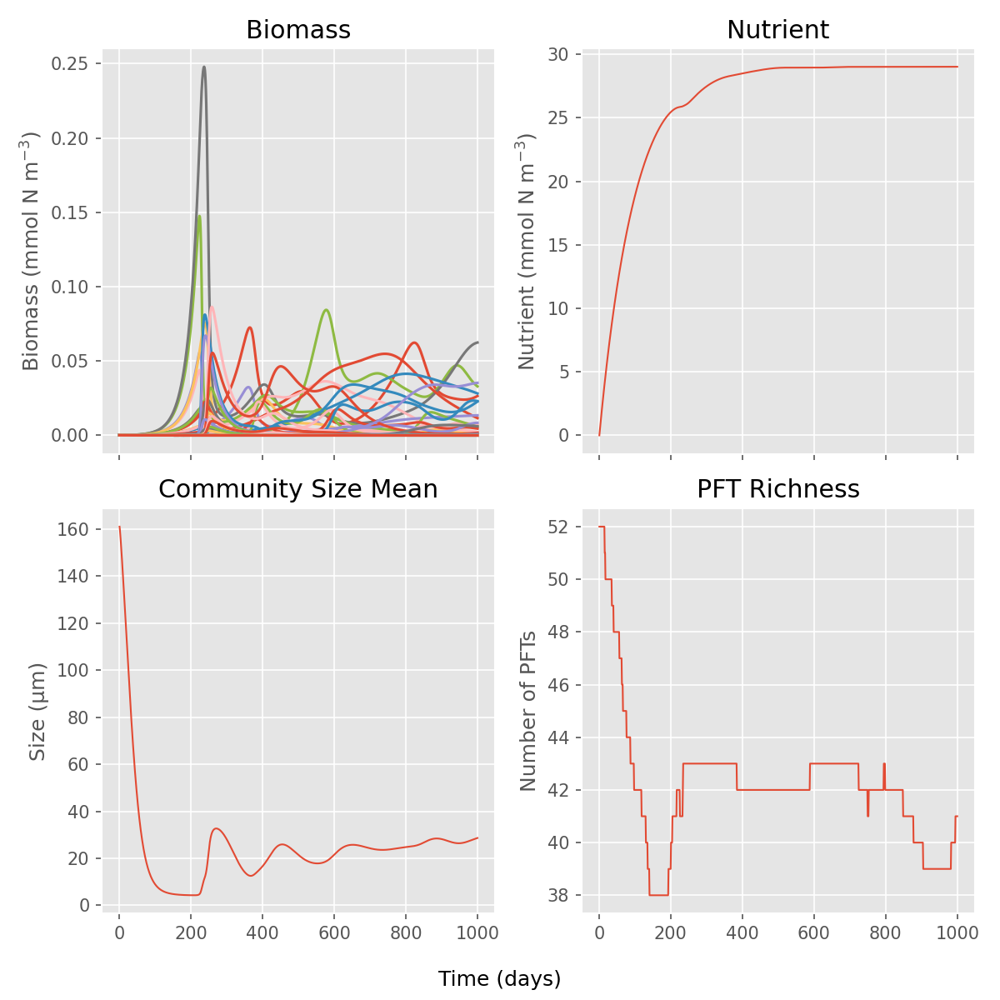

* About

This is a project aiming to adapt the 0D foram model (Grigoratou et al. 2019) to include more foram group with slightly changed coding structure.

It's forked from: https://github.com/mariagrigoratou/Grigoratouetal2019_Biogeosciences_SM

* Quickstart

- Install dependencies with =[uv](https://github.com/astral-sh/uv)=:
#+begin_src sh
    uv sync
#+end_src

- Run the default chemostat scenarios (plots will display):
#+begin_src sh
    uv run run.py
#+end_src

- Save figures to a directory instead of displaying them:
#+begin_src sh
    uv run run.py --scenario baseline --save-dir docs
#+end_src

Example output (=baseline= scenario, one line per PFT):

- Use the library directly if you want programmatic control:
#+begin_src python
    from chemostat import Chemostat

    model = Chemostat(25, 1)
    model.load_ecoconfig("model_config.toml")

    model.run()
    model.plot()
#+end_src

* Code organisation

The library follows Phydra's separation between reusable ecological components,
an assembled model, and experiments ([[https://github.com/ben1post/phydra#package-structure][Phydra's package structure]]).
It keeps the existing SciPy solver and TOML configuration files.

#+begin_example
chemostat/
    components.py   Uptake, grazing, mortality, respiration, dilution, nutrient supply
    model.py        Combines the processes and runs the ODE solver
    traits.py       Size-dependent traits, foram morphotypes, prey preferences
    config.py       Reads TOML and sets up the plankton community
    plotting.py     Plots a completed simulation
    __init__.py     Exposes Chemostat
run.py                      Standard scenario experiments
run_foram_morphotypes.py     Foram community experiment and figures
run_foram_TN_sweep.py        Temperature–nutrient experiment and figures
#+end_example

The existing =from chemostat import Chemostat= import and run commands still work.
Each model has its own =processes= dictionary, so an experiment can replace a
process without changing the solver or other models. For example, to halve
nutrient uptake by phytoplankton and symbionts:

#+begin_src python
    from chemostat import Chemostat
    from chemostat.components import nutrient_uptake

    def reduced_uptake(N, B, gamma_T, **traits):
        return 0.5 * nutrient_uptake(N, B, gamma_T, **traits)

    model = Chemostat(20, 2.5)
    model.load_ecoconfig("model_config.toml")
    model.processes["uptake"] = reduced_uptake
    model.run()
#+end_src

Replaceable processes are =uptake=, =zooplankton_grazing=, =foram_grazing=,
=mortality=, =dilution=, =respiration=, and =nutrient_supply=. Replacements must
accept the same arguments as the corresponding function in =components.py=.
Uptake and biomass losses return one rate per PFT; nutrient supply returns a
scalar. Grazing adds prey losses and predator gains to =dBdt= in place. The model
uses the returned uptake for both biomass growth and nutrient drawdown.

The assembled model retains the state layout =[nutrient, biomass per PFT]= and
the existing temperature and light rules. The components are ordinary NumPy
functions; this package does not require Phydra or XSO.

Run the checks with =uv run --extra dev pytest=. The tests include comparisons
against saved results from before the refactor for both TOML configurations.

* References

Grigoratou, M., Monteiro, F. M., Schmidt, D. N., Wilson, J. D., Ward, B. A., and Ridgwell, A.: A trait-based modelling approach to planktonic foraminifera ecology, Biogeosciences, 16, 1469–1492, https://doi.org/10.5194/bg-16-1469-2019, 2019.

Ward, B. A., Dutkiewicz, S., & Follows, M. J. (2014). Modelling spatial and temporal patterns in size-structured marine plankton communities: Top–down and bottom–up controls. Journal of Plankton Research, 36(1), https://doi.org/10/f5pg4b
